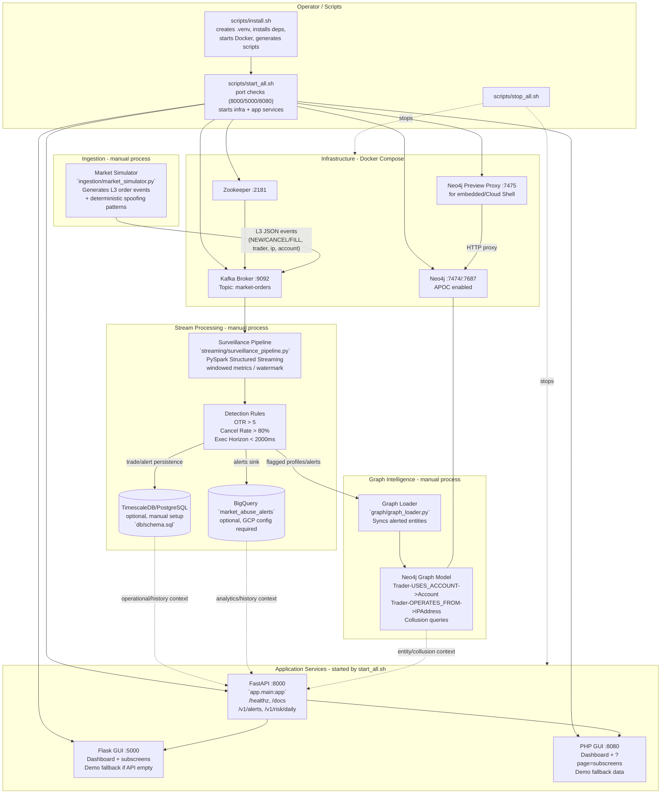

# Distributed Trade Surveillance & Market Abuse Detector

Enterprise-grade platform for ingesting high-throughput Level 3 (L3) order book data, processing in real-time, and detecting market manipulation (Spoofing/Layering) for SEC Rule 10b-5 and FINRA Rule 5210 compliance.

## Architecture

| Component | Technology | Purpose |
|-----------|------------|---------|
| Message Broker | Apache Kafka + Zookeeper | L3 order book event streaming |
| Stream Processing | PySpark Structured Streaming | Real-time windowed analytics & detection |
| Graph Database | Neo4j (APOC) | Entity resolution & collusion detection |
| Time-Series DB | TimescaleDB/PostgreSQL | Operational trade storage (manual setup) |
| Data Warehouse | Google BigQuery | Alert storage & historical analytics (optional/GCP) |
| API | FastAPI | Privacy-preserving compliance endpoints |
| GUIs | Flask, PHP | Web dashboards (demo data fallback when API has no alerts) |

## Complete Flow Diagram



**How to read it**
- **Auto-started (local demo path):** `start_all.sh` checks ports, starts Docker infra, Neo4j preview proxy, FastAPI, Flask, and PHP. `stop_all.sh` stops them.
- **Manual pipeline path:** Market simulator, Spark surveillance pipeline, and graph loader run separately; they move data from Kafka into detection outputs, TimescaleDB/BigQuery (optional), and Neo4j.
- **UI path:** FastAPI exposes compliance endpoints; Flask/PHP render dashboards. GUIs show demo data when live alert/risk data is not present.
- **Config:** Service endpoints/credentials live in `config/config.yaml`; DB setup is handled by `scripts/setup_timescaledb.sh` and `scripts/setup_bigquery.sh`.

## Project Structure

```
├── app/                    # FastAPI application
├── analytics/              # BigQuery SQL analytics
├── config/                 # Configuration (config.yaml, .env.example)
├── db/                     # Database schemas (TimescaleDB/PostgreSQL)
├── graph/                  # Neo4j graph loader
├── infra/                  # Docker (docker-compose.yml, neo4j-preview-proxy.conf)
├── ingestion/              # Market simulator (Kafka producer)
├── scripts/                # Install/start/stop + DB setup scripts
├── streaming/              # PySpark surveillance pipeline
├── tests/                  # Unit tests
└── web/                    # Flask & PHP GUIs
```

## Quick Start

### 1. Install Dependencies & Infrastructure
```bash
chmod +x scripts/*.sh
./scripts/install.sh
```
Creates `.venv`, installs Python deps, starts Docker infra, and (re)generates `scripts/start_all.sh` / `scripts/stop_all.sh`.

### 2. Configure (before first run if needed)
- Copy/edit config: `config/config.yaml` (or `config/.env.example` → `.env` where supported).
- TimescaleDB/BigQuery are **not** required to start the local UIs; configure them when you run the DB/pipeline sinks (see [Database Setup](#database-setup)).

### 3. Start All Services
```bash
./scripts/start_all.sh
```
`start_all.sh` now:
- checks ports **8000/5000/8080** and aborts with a clear error if any is in use
- starts Docker infra (Zookeeper, Kafka, Neo4j, Neo4j preview proxy)
- launches **FastAPI (8000)**, **Flask GUI (5000)**, **PHP GUI (8080)** and verifies listeners
- writes logs to `/tmp/fastapi.log`, `/tmp/flask.log`, `/tmp/php.log`

### 4. Run Pipeline Components (optional, separate terminals)
```bash
source .venv/bin/activate
python ingestion/market_simulator.py                 # Kafka producer
spark-submit streaming/surveillance_pipeline.py      # requires Java + Spark config
python graph/graph_loader.py                         # Neo4j entity loading
```

### 5. Stop All Services
```bash
./scripts/stop_all.sh
```

## Access Points

| Service | URL | Notes |
|---------|-----|-------|
| Neo4j Browser (direct) | http://localhost:7474/browser/ | `neo4j` / `surveillance123` |
| Neo4j Browser (preview) | http://localhost:7475/browser/ | Use for Cloud Shell/embedded preview; forward **7687** for Bolt |
| Neo4j Bolt | `bolt://localhost:7687` | - |
| Kafka | `localhost:9092` | Topic `market-orders` |
| Zookeeper | `localhost:2181` | - |
| FastAPI Docs | http://localhost:8000/docs | API root `/` returns 404 by design; use `/docs`, `/healthz`, `/v1/*` |
| Flask GUI | http://localhost:5000 | Dashboard/subscreens show demo data when `/v1/alerts` is empty |
| PHP GUI | http://localhost:8080 | Subscreens: `?page=alerts|traders|pipeline|graph|api` |

> If a localhost service is unavailable, run `ss -tlnp | grep -E '7474|7475|7687|8000|5000|8080'`, check `/tmp/*.log`, and ensure the port is forwarded in your environment.

## Configuration

Edit `config/config.yaml` (or copy `config/.env.example` to `.env` where supported).

| Area | `config/config.yaml` key | What to set |
|------|--------------------------|-------------|
| Kafka | `kafka.*` | broker/topic (default `localhost:9092`, `market-orders`) |
| Neo4j | `neo4j.*` | `bolt://localhost:7687`, credentials |
| TimescaleDB/PostgreSQL | `timescaledb.*` | host/port/db/user/password and **`connection_string`** |
| BigQuery | `bigquery.*` | `project_id`, `dataset`, `table_alerts`, `credentials_path`, `location`, `temporary_gcs_bucket` |
| Spark | `spark.*` | master, checkpoint, jars (requires Java) |
| API/GUI | `api.*`, `gui.*` | bind host/ports/CORS |

### TimescaleDB (`config/config.yaml`)
```yaml
timescaledb:
  host: "localhost"
  port: 5432
  database: "surveillance"
  user: "surveillance"          # app user (not superuser)
  password: "<your_password>"
  schema: "public"
  ssl_mode: "prefer"
  pool_size: 20
  connection_string: "postgresql://surveillance:<your_password>@localhost:5432/surveillance"
```
Keep `connection_string` consistent with the fields above. Do not commit real passwords.

### BigQuery (`config/config.yaml`)
```yaml
bigquery:
  project_id: "<your-gcp-project-id>"
  dataset: "surveillance"
  table_alerts: "market_abuse_alerts"
  credentials_path: "./config/gcp-sa-key.json"   # service-account JSON; do not commit
  location: "US"
  temporary_gcs_bucket: "<your-temp-gcs-bucket>" # for Spark BigQuery writes
```
Also replace placeholder `your-gcp-project-id` references in `analytics/historical_analytics.sql` and override the default in `streaming/surveillance_pipeline.py` for real runs.

## Database Setup

### TimescaleDB/PostgreSQL (Manual Setup Required)
Not containerized. Requires PostgreSQL (+ TimescaleDB extension recommended) and `psql`.

```bash
sudo apt-get install -y postgresql-client
chmod +x scripts/setup_timescaledb.sh

# Run as/administered by a PostgreSQL superuser context
PGPASSWORD='<postgres_admin_password>' ./scripts/setup_timescaledb.sh

# Custom
DB_HOST=localhost DB_PORT=5432 DB_SUPERUSER=postgres DB_NAME=surveillance \
DB_USER=surveillance DB_PASSWORD='change_me' PGPASSWORD='<admin_pw>' \
./scripts/setup_timescaledb.sh

# If DB/role already exist
SKIP_CREATE=1 PGPASSWORD='<admin_pw>' DB_NAME=surveillance DB_USER=surveillance ./scripts/setup_timescaledb.sh
```
The script enables `timescaledb` if available and applies `db/schema.sql`. Manual helper: `scripts/setup_timescaledb.sql`.

### Neo4j
Auto-configured via Docker (`infra/docker-compose.yml`). Direct: http://localhost:7474/browser/, preview-proxied (embedded): http://localhost:7475/browser/. Credentials: `neo4j` / `surveillance123`.

### Google BigQuery
1. Create a GCP project, enable BigQuery (and Storage if using temp GCS bucket).
2. Create dataset/table (partitioned/clustered):
   ```bash
   ./scripts/setup_bigquery.sh --print-ddl
   GCP_PROJECT=<id> BQ_LOCATION=US ./scripts/setup_bigquery.sh
   ```
   DDL also available via `streaming/surveillance_pipeline.py:get_bigquery_ddl()`.
3. Create service account, download JSON key, set `bigquery.credentials_path` (do not commit).
4. Set `project_id`, `dataset`, `table_alerts`, `location`, `temporary_gcs_bucket`; update `analytics/historical_analytics.sql` placeholders.

### Kafka
Auto-configured via Docker. Topic `market-orders` is auto-created.

## Detection Logic (Configurable)

Detection thresholds are configured in `config/config.yaml` under `detection:` (and read by `streaming/surveillance_pipeline.py` via `config/detection_config.py`).

**Default spoofing rule** (`detection.rules.spoofing`):
- **Order-to-Trade Ratio (OTR)** > `min_order_to_trade_ratio` (default **5.0**)
- **Cancellation Rate** > `min_cancellation_rate` (default **0.80** = 80%)
- **Execution Horizon** < `max_execution_horizon_ms` (default **2000** ms)

```yaml
detection:
  window_duration_seconds: 10
  window_slide_seconds: 5
  watermark_seconds: 2
  rules:
    spoofing:
      enabled: true
      min_order_to_trade_ratio: 5.0
      min_cancellation_rate: 0.80
      max_execution_horizon_ms: 2000
```

**Quick runtime overrides (no YAML edit):**
```bash
DETECTION_OTR_MIN=8 DETECTION_CANCEL_RATE_MIN=0.9 DETECTION_EXEC_HORIZON_MAX_MS=1500 \
spark-submit streaming/surveillance_pipeline.py
```

## Testing

```bash
source .venv/bin/activate
pytest
```

## Notes
- TimescaleDB is not containerized - setup manually (`scripts/setup_timescaledb.sh` / `db/schema.sql`).
- BigQuery requires GCP project/service account credentials; optional for local UI/demo flow.
- PySpark requires a Java runtime and correct Spark/BigQuery connector config.
- GUIs may display demo data when no live alerts exist in the API/pipeline.
